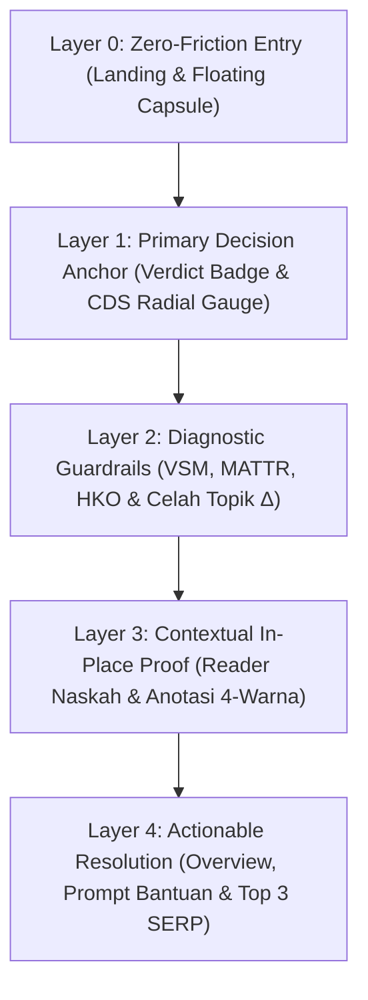

# TECHNICAL BLUEPRINT & UX SPECIFICATION: PRE-PUBLISHING QUALITY GATEKEEPER

> **Dokumen Resmi Handover:** System Analyst (Chat 1) $\rightarrow$ DevOps & GitHub Dispatcher (Chat 2)  
> **Proyek:** Pre-Publishing Quality Gatekeeper (White-Box Editorial & IR Audit System)  
> **Target Implementasi Saat Ini:** Katalog Mockup Interaktif & Spesifikasi Visual di Mokly (`specs/gatekeeper/*.mockup.tsx`)  
> **Rujukan Desain Dasar:** Prototipe Eksisting (`/home/saifmpleh/Downloads/riset/program/index.html`) & 11 Gambar Mockup (`/home/saifmpleh/Downloads/riset/gambar mockup/`)

---

## 1. KONTEKS & PARADIGMA DESAIN (ZERO-HALLUCINATION)

Sistem **Pre-Publishing Quality Gatekeeper** adalah instrumen evaluasi pra-publikasi terbuka (*white-box*) berbasis web untuk menilai kelayakan, diferensiasi informasi (*Information Gain*), dan kewajaran stilometri draf artikel web informasional berbahasa Indonesia terhadap korpus **Top 3 Google SERP Indonesia** (`gl=id, hl=id`) secara deterministik.

### 1.1. Keputusan Paradigma UX (Hasil Evaluasi Komparatif)
Berdasarkan bedah komparatif antara 5 pola antarmuka *guest/pre-login* (**Gemini, ChatGPT, ZeroGPT, Gauth, Sparkian**), sistem ini menetapkan pola **Hibrida Gemini + ChatGPT (Mobile-First Conversational Audit Feed)** dengan prinsip mutlak:
1. **Zero-Login & Zero-Friction:** Tidak ada tembok autentikasi (*auth wall*), tidak ada *banner* promosi pemasaran di bawah layar (anti-Gauth), dan tidak ada *pop-up cookie/quota* yang menutupi ruang kerja (anti-Sparkian).
2. **Anti-Traditional Utility Box:** Menolak tampilan *form* kaku ala ZeroGPT. Interaksi mengalir secara vertikal dalam satu kolom (*single-stream card-stack*) layaknya asisten AI modern.
3. **Mobile-First Frame Ergonomics:** Dirancang khusus untuk kanvas seluler (`360px` – `390px` x `844px`) yang ketika dibuka di layar Desktop tetap tampil presisi sebagai *centered mobile-first workspace* di atas latar belakang tenang (`#E2E8F0`).

---

## 2. BEDAH HIERARKI UX (STAFF PRODUCT DESIGNER — DECISION-MAKING ERGONOMICS)

Desain antarmuka dibagi ke dalam **5 Lapisan Kognitif (*5-Layer Scannability*)** agar Penulis Konten / Web Editor dapat mengambil keputusan revisi dalam waktu kurang dari **2 detik** sejak hasil audit muncul:

### Layer 0 — Zero-Friction Entry (State Awal / Tanpa Login)
* **Top Header Minimalis (`56px`):**
  * Kiri: Tombol Hamburger (`☰`) untuk membuka *Sidebar Drawer Riwayat Sesi Audit* (**FR-12**).
  * Tengah: Ikon Perisai Gradien (`#6366F1` $\rightarrow$ `#8B5CF6` $\rightarrow$ `#38BDF8`) + Judul `Gatekeeper Audit`.
  * Kanan: Tombol Menu Utilitas Titik Tiga (`⋮`) untuk ekspor & manajemen sesi (**UC-05 / FR-12**).
* **Central Hero Greeting (Gaya Gemini):**
  * Ikon Perisai 3D (`80x80px`, `border-radius: 24px`, bayangan lembut `#6366F1/25%`).
  * Tipografi Utama: **"Segera Periksa, ARTIKELMU!"** (`30px`, ExtraBold `800`, aksen gradien Indigo-Violet-Sky).
  * Sub-teks Edukatif Ringkas: *"Evaluasi diferensiasi topik & stilometri draf terhadap Top 3 Google SERP Indonesia."*
* **Quick-Start Action Chips (Adopsi Ergonomi ChatGPT/Gauth):**
  * Menampilkan 2 tombol pintas tepat di bawah Hero untuk mencegah *blank-canvas paralysis*:
    1. `⚡ Muat Sampel Kopi Tubruk (340 kata)` $\rightarrow$ Mengisi otomatis kueri & naskah uji.
    2. `📄 Unggah Dokumen (.md, .txt, .docx)` $\rightarrow$ Membuka dialog unggah berkas (**FR-01**).
* **Persistent Floating Input Capsule (Bawah):**
  * **Baris Konteks Mikro (Di Atas Kapsul):** Menampilkan *pill* indikator kueri aktif (`🔍 Kueri: "resep kopi tubruk tradisional"`) dan penghitung kata *real-time* (`342 / min. 300 kata` — memvalidasi aturan **FR-02** sebelum *submit*).
  * **Kapsul Utama (`border-radius: 28px`):**
    * Kiri: Tombol bulat `(+)` (`40x40px`) untuk memicu **Bottom Sheet Opsi Audit & Masukan**.
    * Tengah: Input `<textarea>` *auto-grow* dengan *placeholder* `"Ketik atau tempel naskah (min. 300 kata)..."`.
    * Kanan: Tombol utama `[🛡️ Audit]` berwarna `#0F172A` (dilengkapi proteksi *anti-rage click* / `disabled` saat proses komputasi berjalan).

### Layer 1 — Primary Decision Anchor (Vonis & CDS Radial Gauge — FR-10)
* **Pertanyaan Kognitif Pengguna:** *"Apakah draf saya layak terbit sekarang?"*
* **Hierarki Visual:**
  * Header Kartu: Judul **"Status Kelayakan"**, subjudul *"Content Differentiation Score (CDS)"*, dan **Badge Vonis** (`Perlu Revisi` dengan warna Amber `#FEF3C7`/`#B45309`, atau `Siap Terbit` dengan warna Emerald `#ECFDF5`/`#047857`).
  * **Semi-Circle Radial Gauge (SVG `viewBox="0 0 220 124"`):**
    * Menampilkan skor agregat CDS skala `0–100%` dalam angka tabular besar (`38px`, ExtraBold `800`).
    * Menampilkan garis penanda (*threshold tick*) pada posisi ambang kelulusan standar (`75`).
  * **Kalimat Diagnosis Kausal:** Menjelaskan secara instan selisih poin terhadap ambang batas beserta akar penyebab utamanya (contoh: *"5 poin di bawah ambang lolos (75%). Penyebab utama: **3 topik penting** belum dibahas."*).

### Layer 2 — Diagnostic Guardrails (Stilometri, VSM & Celah Topik — FR-07, FR-08, FR-09)
* **Pertanyaan Kognitif Pengguna:** *"Parameter matematis apa yang menahan skor saya, dan entitas topik apa yang kurang?"*
* **Blok A — Metrik Stilometri & Leksikal (3 Progress Bar Horizontal dengan Garis Batas):**
  1. **VSM Cosine Similarity (FR-07):** Mengukur kemiripan vektor TF-IDF (*sublinear TF*) draf terhadap korpus Top 3 SERP. Menampilkan nilai maksimal & rata-rata, garis batas toleransi `≤ 0.60`, dan lencana status (`Aman` / `Mendekati Batas` / `Indikasi Duplikasi`).
  2. **MATTR & TTR — Kekayaan Leksikal (FR-09):** Mengukur variasi kosakata pada jendela bergerak 50 token (*Moving-Average Type-Token Ratio*). Menampilkan nilai aktual (misal `0.61`), garis batas standar `≥ 0.55`, dan lencana status (`Kaya` / `Rendah`).
  3. **HKO — Heading-Keyword Overlap (FR-09):** Mengukur persentase repetisi token kueri pada sub-judul `H1–H3` untuk mendeteksi *keyword stuffing*. Menampilkan nilai aktual (misal `25%`), garis batas wajar `≤ 40%`, dan lencana status (`Wajar` / `Keyword Stuffing`).
* **Blok B — Celah Topik / Information Gain Set Calculator (FR-08):**
  1. **Defisit Topik Kompetitor ($\Delta_{\text{deficit}} = E_{\text{SERP}} \setminus E_{\text{draft}}$):** Deretan *chip* berwarna Oranye (`#FFF7ED`, teks `#C2410C`, ring `#FED7AA`) yang memuat frasa kunci/entitas YAKE + Unigram/Bigram yang muncul konsisten di Top 3 SERP namun absen di draf pengguna (contoh: `Takaran Suhu 90°C`, `Rasio Seduh 1:15`, `Tingkat Gilingan Bubuk`).
  2. **Poin Kebaruan Unik ($\Delta_{\text{gain}} = E_{\text{draft}} \setminus E_{\text{SERP}}$):** Deretan *chip* berwarna Emerald (`#ECFDF5`, teks `#047857`, ring `#A7F3D0`) yang memuat entitas orisinal di draf pengguna yang tidak dimiliki kompetitor (contoh: `Robusta Dampit`, `Pemanis Aren Alami`).

### Layer 3 — Contextual In-Place Proof (Naskah Terkurasi & Anotasi 4-Warna — FR-11)
* **Pertanyaan Kognitif Pengguna:** *"Kalimat atau sub-judul mana di dalam naskah saya yang bermasalah?"*
* **Hierarki Visual:**
  * **Grid Legenda Interaktif 2x2 (Filter Toggle):**
    * 🟨 **Kuning (`#FEF3C7` / border `#FBBF24`):** Repetisi Sub-judul (HKO Overlap).
    * 🟥 **Merah (`#FFE4E6` / border `#FB7185`):** Kemiripan Kalimat Tinggi (VSM Cosine).
    * 🟦 **Biru (`#E0F2FE` / border `#38BDF8`):** Saran Sisipan Entitas ($\Delta_{\text{deficit}}$) dengan *inline pill* `+ suhu air 90°C · rasio 1:15`.
    * 🟩 **Hijau (`#D1FAE5` / border `#34D399`):** Poin Unik / Kebaruan Asli ($\Delta_{\text{gain}}$).
  * **Reader Box Naskah (`background: #FAF9F6`, font Serif `Source Serif 4`, `15px`, `line-height: 1.8`):** Menampilkan teks draf dengan sorotan stabilo pastel sesuai hasil pemetaan indeks kalimat.
  * **Kartu Catatan Anotasi Kontekstual (Di Bawah Reader Box):** Menampilkan penjelasan diagnostik detail untuk segmen kalimat yang sedang dipilih/diklik.

### Layer 4 — Actionable Resolution & Ground Truth (Overview, Prompt Bantuan & SERP — FR-03, FR-04, FR-05, FR-13)
* **Pertanyaan Kognitif Pengguna:** *"Bagaimana cara tercepat memperbaiki draf ini dan siapa kompetitor pembandingnya?"*
* **Blok A — Overview & Rekomendasi Editorial:** Daftar bernomor (1–4) yang merangkum langkah revisi konkret.
* **Blok B — Prompt Bantuan Remediasi AI (`prompt-bantuan.txt`):**
  * Kontainer kode bergaya terminal gelap (`#0F172A`, teks `#E2E8F0`, font `JetBrains Mono` `11px`) yang menggabungkan `[DRAF NASKAH ASLI]` dan `[INSTRUKSI PERBAIKAN BERDASARKAN HASIL AUDIT]`.
  * Tombol penuh (`width: 100%`) `[📋 Salin Prompt]` berwarna Indigo (`#4F46E5`) untuk menyalin *prompt* ke *clipboard*.
* **Blok C — Referensi SERP Top 3 Google & Indikator Graceful Degradation (FR-03, FR-04, FR-05, FR-13):**
  * Menampilkan 3 kartu artikel kompetitor organik dari Serper.dev API (setelah melewati penyaringan URL non-artikel **FR-04**: mengabaikan YouTube, media sosial, e-commerce, dan PDF).
  * Setiap kartu menampilkan: Lencana Peringkat (`1`, `2`, `3`), nama domain, judul artikel H1, lencana skor *pairwise Cosine Similarity* (`Cosine 0.48`), jumlah kata bersih hasil ekstraksi XML Trafilatura (`1.180 kata`), dan tombol tautan eksternal.
  * **Komponen Wajah Degradasi Parsial (FR-13):** Menyediakan tampilan khusus ketika 1 URL gagal diunduh (HTTP 403/Timeout meskipun sudah melalui *fallback* `curl_cffi`), berupa *banner* informasi tenang: *"⚠️ 1 URL kompetitor terproteksi anti-bot dan diabaikan. Audit dieksekusi secara proporsional menggunakan 2 korpus kompetitor valid (FR-13)."*

---

## 3. PEMETAAN KEBUTUHAN SISTEM KE KOMPONEN UI (TRACEABILITY MATRIX)

| Kode Spesifikasi | Deskripsi Kebutuhan Sistem | Implementasi Komponen UI pada Mockup |
| :--- | :--- | :--- |
| **UC-01 / FR-01** | Menerima Input Kueri & Draf Teks (`.md`, `.txt`, `.docx`) | *Floating Composer Capsule* (bawah) + *Bottom Sheet* (`File Dokumen` & `Kueri Target`). |
| **FR-02** | Validasi Panjang Teks Draf (**Minimal 300 Kata**) | *Word Counter Pill* (`342 / min. 300 kata`) di atas kapsul input & status validasi tombol `[Audit]`. |
| **UC-02 / FR-03** | Akuisisi Data Top 3 SERP Otomatis (`gl=id, hl=id`) | *Audit Loading Stepper* (Langkah 1: Mengambil Top 3 Google SERP) & Seksi *Referensi SERP*. |
| **FR-04** | Penyaringan URL Non-Artikel (Sosmed, YouTube, Marketplace, PDF) | Lencana informasi pada header *Referensi SERP*: *"3 artikel organik valid (2 URL non-artikel/e-commerce disaring otomatis)"*. |
| **FR-05** | Perayapan HTTPX / `curl_cffi` & Ekstraksi XML Trafilatura | *Audit Loading Stepper* (Langkah 2: Ekstraksi teks utama & heading H1–H3) + info jumlah kata per kompetitor. |
| **FR-06** | Rangkaian Pra-pemrosesan Teks NLP Indonesia (Sastrawi + Stopwords + YAKE) | *Audit Loading Stepper* (Langkah 3 & 4) dengan rincian waktu komputasi (misal `4.8 dtk`). |
| **FR-07** | Kalkulasi VSM TF-IDF & Cosine Similarity | Bar progres pertama pada seksi *Metrik Stilometri & Leksikal* + skor *Cosine* per kartu kompetitor. |
| **FR-08** | Ekstraksi Information Gain ($\Delta_{\text{deficit}}$ & $\Delta_{\text{gain}}$) | Seksi *Celah Topik · Information Gain* dengan *chip* Oranye ($\Delta_{\text{deficit}}$) dan Hijau ($\Delta_{\text{gain}}$). |
| **FR-09** | Evaluasi Batas Stilometri Teks (TTR, MATTR, HKO) | Bar progres kedua (`MATTR ≥ 0.55`) dan ketiga (`HKO ≤ 40%`) pada seksi *Metrik Stilometri & Leksikal*. |
| **UC-03 / FR-10** | Agregasi Keputusan Gatekeeper (CDS 0–100 & Vonis) | Seksi *Status Kelayakan* dengan *Semi-Circle Radial Gauge* CDS dan *Badge* Vonis. |
| **UC-04 / FR-11** | Visualisasi Bukti Diagnostik Transparan (*White-Box*) | Seksi *Naskah Terkurasi & Anotasi* (4 warna stabilo) + *Overview* + *Prompt Bantuan*. |
| **UC-05 / FR-12** | Penyimpanan Riwayat SQLite & Unduh Snapshot JSON | *Sidebar Drawer Kiri* (`Riwayat Audit`) + *Menu Dropdown Titik Tiga (`⋮`)* (`Unduh Snapshot Laporan JSON`). |
| **FR-13** | Pencegahan Kegagalan & Degradasi Parsial (*Graceful Degradation*) | *Banner* status degradasi parsial (2 dari 3 URL berhasil) & *toast/alert* penghentian jika `< 2` URL. |
| **UC-06** | Mengonfigurasi Ambang Batas Kelayakan | Kartu *Ambang Batas* (`VSM ≤ 0.60`, `MATTR ≥ 0.55`, `HKO ≤ 40%`, `Skor Lolos ≥ 75%`) di *Bottom Sheet*. |

---

## 4. SPESIFIKASI TEKNIS MOKLY (ATURAN WAJIB TANPA HALUSINASI)

> [!IMPORTANT]
> **Fakta Arsitektur `@mokly/mokly` v0.15.0 di Workspace Ini:**
> 1. Konfigurasi `mokly.config.ts` mengarahkan `mockupsDir: "specs/generated"`.
> 2. Compiler `npx mokly generate` merender properti `desktop` dan `mobile` dari setiap file `specs/**/*.mockup.tsx` menjadi HTML statis murni (`index.desktop.html` dan `index.mobile.html`) melalui React Server-Side Rendering **TANPA pipeline kompilasi Tailwind CSS eksternal**.
> 3. Oleh karena itu, **DILARANG** hanya mengandalkan atribut `className="..."` Tailwind tanpa definisi gaya. Setiap file `*.mockup.tsx` **WAJIB** menggunakan objek `style={{ ... }}` React standar dan/atau menyertakan blok `` mandiri di dalam elemen pembungkus utama agar tampilan ter-render 100% akurat di server Mokly (`http://127.0.0.1:4173`) dan lulus `npx mokly check`.

### 4.1. Palet Warna & Token Desain Baku (Design Tokens)
* **Background Canvas (Desktop Outer):** `#E2E8F0` (Slate 200)
* **App Container (Mobile Frame `390px`):** `#FFFFFF` (Putih Bersih), Border `#E2E8F0`, Shadow `0 25px 60px -15px rgba(15, 23, 42, 0.25)`
* **Brand Primary / Shield Accent:** Gradien `linear-gradient(135deg, #4F46E5 0%, #7C3AED 50%, #0284C7 100%)`
* **Text Hierarchy:**
  * Primary Heading & Skor: `#0F172A` (Slate 900)
  * Body & Sub-heading: `#334155` (Slate 700)
  * Muted / Caption / Meta: `#64748B` (Slate 500) & `#94A3B8` (Slate 400)
* **Semantic Status & Annotation Tokens:**
  * **Emerald (Lolos / Aman / $\Delta_{\text{gain}}$):** Bg `#ECFDF5`, Text `#047857`, Border `#A7F3D0`, Indicator `#10B981`
  * **Amber (Perlu Revisi / HKO Kuning):** Bg `#FFFBEB` / `#FEF3C7`, Text `#B45309` / `#92400E`, Border `#FDE68A`, Indicator `#F59E0B`
  * **Orange (Defisit Topik $\Delta_{\text{deficit}}$):** Bg `#FFF7ED`, Text `#C2410C`, Border `#FED7AA`, Indicator `#F97316`
  * **Rose (Kritis / Kemiripan Kalimat VSM Merah):** Bg `#FFF1F2` / `#FFE4E6`, Text `#BE123C` / `#9F1239`, Border `#FECDD3`, Indicator `#EF4444`
  * **Sky (Saran Sisipan Defisit Biru):** Bg `#F0F9FF` / `#E0F2FE`, Text `#0369A1` / `#075985`, Border `#BAE6FD`, Indicator `#0284C7`
* **Reader Box Surface:** `#FAF9F6` (Warm Alabaster Paper), Font Serif `'Source Serif 4', Georgia, serif`
* **Prompt Terminal Surface:** `#0F172A` (Slate 900), Text `#E2E8F0`, Font Mono `'JetBrains Mono', monospace`

---

## 5. ARSITEKTUR FILE & PARTISI TUGAS 3 WORKER (UNTUK DEVOPS DISPATCHER)

Untuk mencegah konflik *merge* dan menjaga spesialisasi *pipeline*, implementasi katalog Mokly dibagi menjadi **4 Layar Utama (`specs/gatekeeper/*.mockup.tsx`)** dan dipartisi secara ketat ke **3 Worker**:

### 🛠️ PORSI WORKER 1 (`proyekmagang/worker-1` — Core Engineer)
**Fokus:** Struktur Layar Input, Validasi Aturan Bisnis (FR-01, FR-02, UC-06), Konfigurasi Ambang Batas, dan Riwayat Sesi Audit (FR-12).

1. **Pembersihan Katalog Lama (Opsional sesuai arahan DevOps):**
   * Menjaga atau memigrasikan fokus katalog ke direktori baru `specs/gatekeeper/`.
2. **File 1: `specs/gatekeeper/landing-zero-login.mockup.tsx`**
   * **Judul Layar:** `"1. Gatekeeper Landing (Zero-Login & Quick Start)"`
   * **Cakupan Komponen:**
     * Header Minimalis (`☰`, Logo Perisai + `Gatekeeper Audit`, `⋮`).
     * Central Hero: Perisai 3D Gradien + *"Segera Periksa, ARTIKELMU!"* + sub-teks edukatif.
     * 2 *Quick-Start Action Chips*: `⚡ Muat Sampel Kopi Tubruk (340 kata)` dan `📄 Unggah Dokumen (.md, .txt, .docx)`.
     * *Context Bar* di atas kapsul: `🔍 Kueri: "resep kopi tubruk tradisional"` + indikator validasi **FR-02** (`0 / min. 300 kata`).
     * *Persistent Floating Input Capsule*: Tombol `(+)`, `<textarea>` input draf, dan tombol `[🛡️ Audit]`.
     * Properti `desktop` menampilkan *device frame* `390x844px` di tengah layar beserta panel informasi singkat arsitektur 5-Layer di sebelahnya; properti `mobile` menampilkan tampilan *full-bleed* `100%`.
3. **File 2: `specs/gatekeeper/options-and-history.mockup.tsx`**
   * **Judul Layar:** `"2. Opsi Masukan, Ambang Batas & Riwayat Sesi"`
   * **Cakupan Komponen:**
     * **View A (Bottom Sheet Modal — UC-01 & UC-06):** Menampilkan 4 kartu interaktif:
       1. `📄 File Dokumen`: Unggah Draf Artikel (`.md`, `.txt`, `.docx` — maks 2MB).
       2. `🔍 Kueri Target`: Input teks `"resep kopi tubruk tradisional"` + tombol `[Simpan]`.
       3. `⚡ Sampel Demo`: Muat contoh naskah uji cepat (> 300 kata).
       4. `⚙️ Ambang Batas`: Rincian parameter `VSM Cosine Similarity ≤ 0.60`, `MATTR (Kekayaan Leksikal) ≥ 0.55`, `HKO Overlap (Sub-judul) ≤ 40%`, dan `Skor Lolos Standar ≥ 75%`.
     * **View B (Left Drawer Riwayat Sesi Audit — FR-12):** Menampilkan tombol `[+ Sesi Audit Baru]` dan 3 kartu riwayat snapshot SQLite:
       1. *Kopi Tubruk Tradisional (Versi 2 • CDS 85% Siap Terbit • Lolos Ambang)*
       2. *Panduan Kopi Tubruk (Versi 1 • CDS 70% Perlu Revisi • 3 Defisit)*
       3. *Manfaat Kopi Hitam (Versi 1 • CDS 62% Kritis • 5 Defisit)*

---

### 🎨 PORSI WORKER 2 (`proyekmagang/worker-2` — UI/UX Polish Engineer)
**Fokus:** Visualisasi Diagnostik *White-Box* (FR-07 s.d. FR-11), SVG Radial Gauge, Anotasi Multi-Warna, Prompt Bantuan, dan Referensi SERP (FR-03, FR-04, FR-13).

1. **File 3: `specs/gatekeeper/audit-perlu-revisi.mockup.tsx`**
   * **Judul Layar:** `"3. Hasil Audit White-Box: Status Perlu Revisi (CDS 70%)"`
   * **Cakupan Komponen:**
     * *User Bubble Turn*: Menampilkan kueri `"resep kopi tubruk tradisional"`, cuplikan draf, dan keterangan `342 kata (Versi 1)`.
     * *Pipeline Stepper Ringkas*: Indikator 4 tahapan selesai (`✓ Mengambil Top 3 Google SERP`, `✓ Ekstraksi XML Trafilatura H1–H3`, `✓ VSM TF-IDF & YAKE Information Gain`, `✓ Evaluasi Stilometri MATTR & HKO — 4.8 dtk`).
     * **Seksi 1 — Status Kelayakan:** SVG Semi-Circle Radial Gauge menunjukkan **70%** (warna Amber `#F59E0B`), garis penanda ambang `75`, lencana `Perlu Revisi`, dan penjelasan kausal (*"5 poin di bawah ambang lolos (75%). Penyebab utama: 3 topik penting belum dibahas."*).
     * **Seksi 2 — Metrik Stilometri & Leksikal:** 3 *progress bar* dengan penanda ambang:
       * `VSM Cosine Similarity`: **0.48** (`Batas toleransi ≤ 0.60` $\rightarrow$ Badge `Aman`).
       * `MATTR (Kekayaan Kata)`: **0.61** (`Batas standar ≥ 0.55` $\rightarrow$ Badge `Kaya`).
       * `HKO Overlap (Sub-judul)`: **25%** (`Batas wajar ≤ 40%` $\rightarrow$ Badge `Wajar`).
     * **Seksi 3 — Celah Topik (Information Gain):**
       * $\Delta_{\text{deficit}}$ (3 istilah, chip Oranye): `Takaran Suhu 90°C`, `Rasio Seduh 1:15`, `Tingkat Gilingan Bubuk`.
       * $\Delta_{\text{gain}}$ (2 istilah, chip Emerald): `Robusta Dampit`, `Pemanis Aren Alami`.
     * **Seksi 4 — Naskah Terkurasi & Anotasi 4-Warna:**
       * Grid Legenda 2x2 (`Kuning: HKO`, `Merah: VSM`, `Biru: Saran Sisipan Defisit`, `Hijau: Poin Unik`).
       * Kotak Naskah Serif (`#FAF9F6`) lengkap dengan teks bersorot 4 warna dan *chip* sisipan biru `+ suhu air 90°C · rasio 1:15`.
       * Kartu Detail Anotasi Aktif di bawah naskah.
     * **Seksi 5 — Overview & Prompt Bantuan (`prompt-bantuan.txt`):**
       * Ringkasan 4 poin perbaikan editorial.
       * Kotak terminal gelap (`#0F172A`) berisi teks lengkap prompt remediasi + tombol `[Salin Prompt]`.
2. **File 4: `specs/gatekeeper/audit-siap-terbit-serp.mockup.tsx`**
   * **Judul Layar:** `"4. Iterasi Revisi Lolos (CDS 85%), Top 3 SERP & Ekspor"`
   * **Cakupan Komponen:**
     * *Divider Iterasi*: Lencana `✓ Iterasi Revisi Naskah · Versi 2`.
     * **Status Kelayakan Lolos:** SVG Semi-Circle Radial Gauge menunjukkan **85%** (warna Emerald `#10B981`), lencana `Siap Terbit`, $\Delta_{\text{deficit}}$ = `0 istilah (✓ Seluruh entitas penting kompetitor telah dibahas)`, dan $\Delta_{\text{gain}}$ = `4 istilah`.
     * **Seksi 6 — Referensi SERP Top 3 Google (FR-03, FR-04, FR-05):**
       * Info Filter **FR-04**: *"Menampilkan 3 artikel informasional organik (URL non-artikel/marketplace/video disaring otomatis)"*.
       * Kartu Kompetitor #1: `seduhkopi.example` — *"Cara Membuat Kopi Tubruk Nikmat ala Warung Kopi"* (`Cosine 0.48` · `1.180 kata`).
       * Kartu Kompetitor #2: `resepnusantara.example` — *"Resep Kopi Tubruk Tradisional: Bahan, Takaran, dan Langkah"* (`Cosine 0.41` · `940 kata`).
       * Kartu Kompetitor #3: `ngopidulu.example` — *"Kopi Tubruk: Sejarah, Cara Seduh, dan Tips Anti Ampas"* (`Cosine 0.33` · `1.420 kata`).
     * **Visualisasi State Degradasi Parsial (FR-13):** Menyertakan *card preview* kondisi *Graceful Degradation* ketika 1 URL gagal diunduh setelah *fallback* `curl_cffi` (audit berjalan proporsional dengan 2 korpus kompetitor).
     * **Overlay Menu Titik Tiga (`⋮` — UC-05 / FR-12):** Menampilkan 4 opsi tindakan: `Salin Ringkasan Hasil`, `Unduh Snapshot Laporan (JSON)`, `Salin Teks Artikel Bersih`, dan `Hapus Sesi Ini`.

---

### 🛡️ PORSI WORKER 3 (`proyekmagang/worker-3` — QA & Reliability Engineer)
**Fokus:** Validasi Kompilasi Mokly, Keamanan Markup, Konsistensi Kontrak Data, dan Verifikasi Anti-Regresi.

1. **Verifikasi Build & Manifest Mokly:**
   * Menjalankan `npx mokly generate` untuk memperbarui artefak di `specs/generated/mokly-generated/`.
   * Menjalankan `npx mokly check` dan memastikan kode keluar adalah `0` (100% *PASS*, tidak ada *broken reference* atau *manifest mismatch*).
2. **Audit Kualitas & Keandalan UI:**
   * Memastikan seluruh file `specs/gatekeeper/*.mockup.tsx` menggunakan React `style={{ ... }}` yang valid sehingga HTML statis hasil kompilasi Mokly tampil utuh tanpa ketergantungan pada CDN eksternal yang terblokir.
   * Memastikan tidak ada penggunaan `alert()` atau `confirm()` bawaan browser.
   * Memastikan seluruh teks simbol matematis ($\Delta_{\text{deficit}}$, $\Delta_{\text{gain}}$, $\le$, $\ge$) dan atribut aksesibilitas (`aria-label`, `role="img"`) ter-encode secara aman tanpa cacat karakter.

---

## 6. INSTRUKSI HANDOVER KE DEVOPS (CHAT 2)

Blueprint ini telah final dan bebas halusinasi. Silakan buka **Chat 2 (DevOps & GitHub Dispatcher)** dan berikan perintah berikut:

> *"Baca blueprint teknis di `specs/design-task.md`. Buat GitHub Issue untuk masing-masing Worker (Worker 1, Worker 2, dan Worker 3), siapkan branch fitur terkait, dan dispatch ketiga Worker untuk mengimplementasikan katalog mockup Pre-Publishing Quality Gatekeeper di Mokly hingga `npx mokly check` 100% PASS."*
